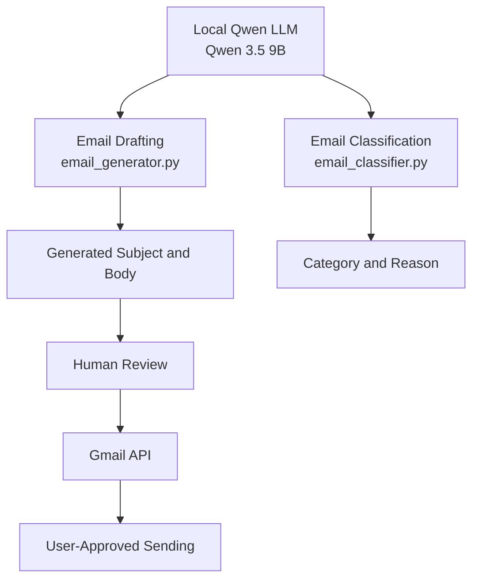
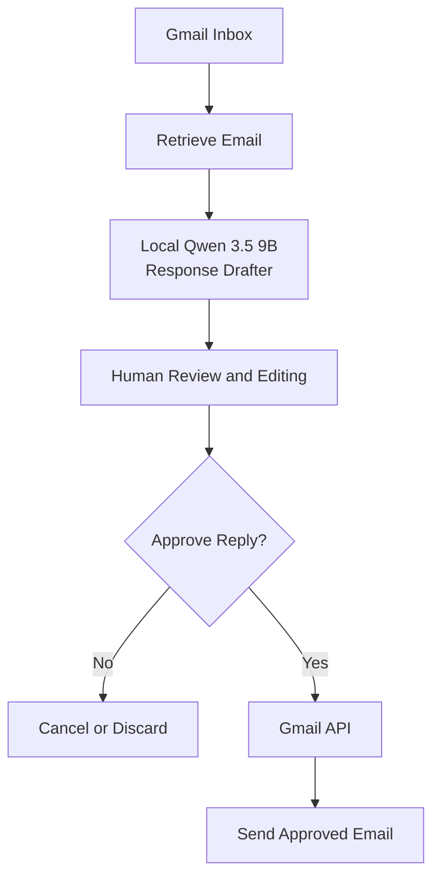
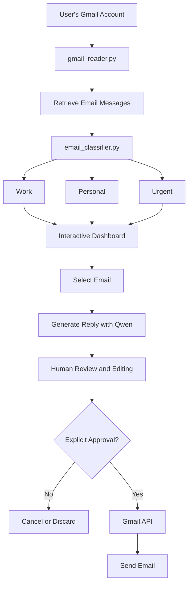
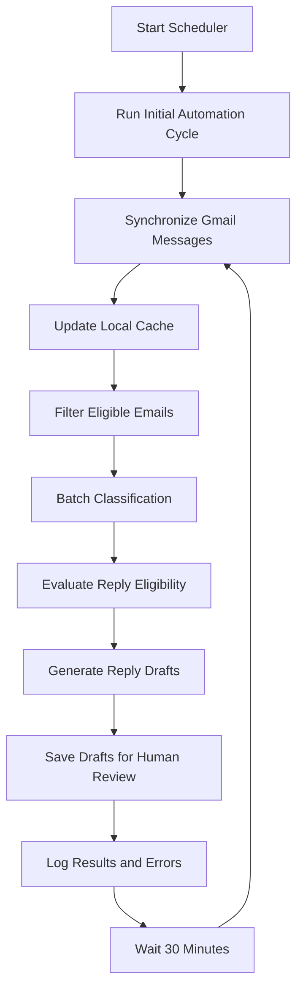
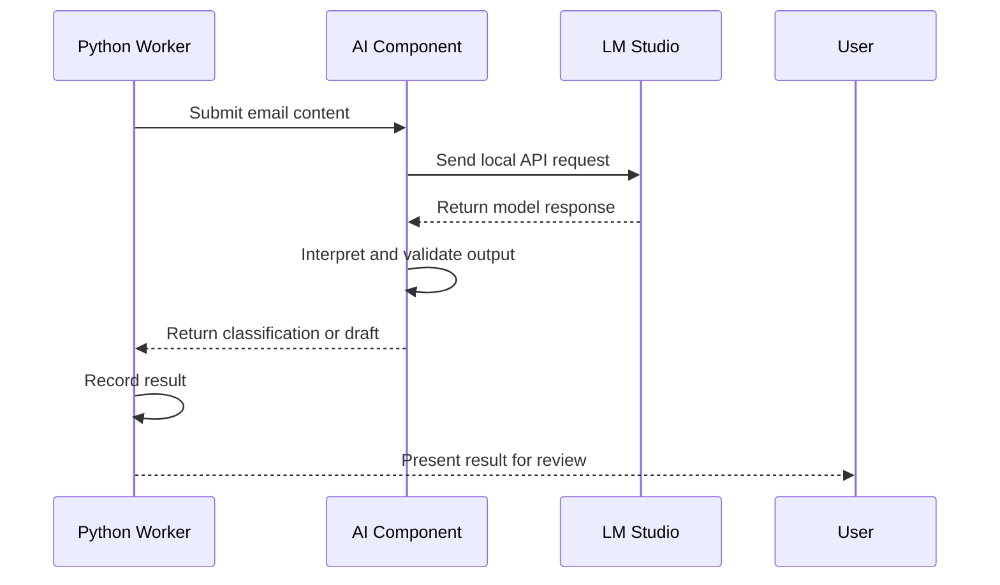

# AI Email Automation Agent

An AI-powered email automation system that integrates Gmail with a locally hosted large language model (LLM) to classify emails, generate reply drafts, and automate repetitive email-management tasks while keeping the user in control of outgoing messages.

The project uses **Qwen 3.5 9B through LM Studio** for local AI processing and integrates with the Gmail API for email access and draft management. It includes email classification, local caching, batch processing, human-reviewed AI responses, and scheduled automation.

The main objective is to demonstrate how AI can support practical email workflows without handing unrestricted control of email communication to an automated system.

> **Safety principle:** AI-generated replies are intended for human review. Automatic sending remains disabled in the scheduled automation workflow.

---

## Table of Contents

- [Project Overview](#project-overview)
- [Project Objectives](#project-objectives)
- [Key Features](#key-features)
- [Technology Stack](#technology-stack)
- [System Architectures](#system-architectures)
- [Current Implementation](#current-implementation)
- [Email Classification](#email-classification)
- [AI Reply Generation](#ai-reply-generation)
- [Gmail Integration and OAuth](#gmail-integration-and-oauth)
- [Scheduled Automation](#scheduled-automation)
- [Installation and Setup](#installation-and-setup)
- [Configuration](#configuration)
- [Running the Application](#running-the-application)
- [Security and Privacy](#security-and-privacy)
- [Testing and Verification](#testing-and-verification)
- [Known Limitations](#known-limitations)
- [Future Work](#future-work)
- [Screenshots and Demonstrations](#screenshots-and-demonstrations)
- [Troubleshooting](#troubleshooting)
- [Project Status](#project-status)
- [License](#license)

---

## Project Overview

Managing an inbox can involve repetitive work: identifying the purpose of each email, deciding which messages need attention, and preparing appropriate replies.

This project explores how a local LLM and Python automation can assist with these tasks.

The system combines:

1. Gmail integration for retrieving and managing email messages.
2. AI-powered email classification.
3. Local LLM inference through LM Studio.
4. AI-assisted reply generation.
5. Local email caching and batch processing.
6. Human review of generated responses.
7. Scheduled automation with logging and error handling.
8. An interactive dashboard workflow for email review and management.

The project is designed to keep AI processing under the user's control and reduce unnecessary exposure of email content to external AI services by using a locally hosted model.

Local inference does not, by itself, guarantee complete privacy. Gmail access, logs, cached messages, and other application components must also be handled securely.

## Project Objectives

The primary objectives are to:

- Automate repetitive email-management tasks.
- Classify messages into useful categories based on their content.
- Use a local language model for classification and response generation.
- Retrieve real Gmail messages through authorized API access.
- Generate contextual reply drafts for eligible messages.
- Require human review before outgoing messages are sent.
- Schedule recurring email-processing cycles.
- Maintain a modular Python implementation that can be tested and extended.
- Document the architecture, setup process, security controls, and future improvements.

## Key Features

### 1. AI Email Classification

The classifier analyses an email's subject and body and returns a category and an explanation for that classification.

Example input:

**Subject:** Your ride receipt is ready

**Body:** Thanks for riding with us. Your trip receipt is ready.

Example classification:

- Category: Transactional
- Reason: The email confirms a completed ride and provides a trip receipt.

The result demonstrates how the system can distinguish transactional notifications from other kinds of email.

### 2. Local LLM Integration

The project uses Qwen 3.5 9B through LM Studio's local API.

The application can send supported requests to the configured local model for classification and response generation.

### 3. AI-Assisted Reply Generation

The reply-generation workflow uses email content as context for a proposed response. The generated response may include a subject and body, depending on the workflow.

Generated text should be reviewed and edited before sending.

### 4. Gmail Integration

The Gmail API provides authorized access to email data and supports the application's email-management workflows.

OAuth 2.0 is used to authorize access. The exact operations available depend on the configured OAuth scopes and the application's implementation.

### 5. Local Caching and Batch Processing

The automation worker synchronizes messages into a local cache and processes eligible messages in batches.

Caching reduces the need to retrieve and process every message from scratch during each run. It also requires appropriate protection of locally stored email data.

### 6. Human Approval

Human oversight is a central design principle.

The automated workflow generates drafts for review rather than automatically sending AI-generated replies. The user can inspect the content and decide what to do next.

### 7. Scheduled Automation

The scheduler runs an initial automation cycle when started and is configured to repeat every 30 minutes.

It records processing activity and is designed to continue after a cycle encounters an error.

### 8. Dashboard Workflow

The project includes an interactive email-review workflow intended to display messages, support selection of an email, and facilitate AI-assisted replies.

The dashboard command, framework details, and final screenshots will be documented against the actual application files before the README is finalized.

---

## Technology Stack

| Technology | Purpose |
|---|---|
| Python | Main application and automation language |
| Qwen 3.5 9B | Local language model for AI-assisted processing |
| LM Studio | Local model hosting and API access |
| Gmail API | Authorized Gmail integration |
| Google OAuth 2.0 | User authorization |
| `requests` | HTTP requests to the local model API |
| `python-dotenv` | Loading environment variables from `.env` |
| `schedule` | Recurring scheduled execution |
| Logging | Automation activity and error reporting |
| Streamlit | Interactive dashboard workflow, where configured in the application |

The exact installed package versions should be recorded from the project's dependency file.

---

# System Architectures

The following diagrams document the main AI workflow, human approval, interactive Gmail workflow, and scheduled automation.

They describe the system's design and should be checked against the final code before being treated as a complete record of every implemented feature.

## Architecture 1: Core AI Architecture

Qwen 3.5 9B supports two main AI tasks: email classification and reply drafting.



The classification branch produces a category and reason. The drafting branch produces a proposed response. Sending is a separate action and must remain subject to the applicable human-approval workflow.

## Architecture 2: Human-Approved Reply Workflow

This architecture illustrates the decision-making process before an email is sent.



The approval decision belongs to the user. An AI-generated response is not permission to send an email.

## Architecture 3: Real Gmail and Interactive Dashboard Workflow

This architecture represents the interactive workflow for retrieving real Gmail messages, classifying them, selecting a message, and preparing a reply.



The categories shown are illustrative examples of the dashboard's intended classification workflow. The actual categories depend on the classifier's configured rules and outputs.

The number of retrieved emails is configurable and can vary between runs; it should not be assumed to remain fixed at 20.

## Architecture 4: Scheduled Automation

The scheduled workflow coordinates recurring email synchronization, caching, classification, and reply-draft generation.



The scheduler is configured to execute immediately at startup and repeat every 30 minutes.

**Important:** The scheduled workflow must not automatically send generated replies. Its purpose is to prepare content for human review.

## Architecture 5: Local LLM Request Flow

This diagram illustrates how the Python application communicates with the locally hosted model.



This architecture separates email orchestration from model inference. The model is accessed through an API endpoint configured in the application rather than requiring the Python code to host the model itself.

---

## Current Implementation

The following summarizes the work completed or observed during development. It distinguishes verified behavior from work that still requires confirmation.

### Email Classification

- Implemented and executed `email_classifier.py`.
- Tested classification with a transactional ride-receipt email.
- Received a `Transactional` category with a corresponding explanation.
- Configured the application to use the local LM Studio API by default.

### Local LLM Configuration

The application configuration includes:

```python
import os
from dotenv import load_dotenv

load_dotenv()

LLM_BASE_URL = os.getenv(
    "LLM_BASE_URL",
    "http://localhost:1234/v1"
)

LLM_MODEL = os.getenv(
    "LLM_MODEL",
    "qwen/qwen3.5-9b"
)
```

The model identifier must match the model identifier exposed by the user's LM Studio installation.

### Gmail Synchronization and Automation

The automation worker has been run against Gmail and reported the following during an observed cycle:

| Activity | Observed result |
|---|---:|
| Emails synchronized | 100 |
| Cache before synchronization | 1,400 |
| Cache after synchronization | 1,500 |
| Emails classified successfully | 10 |
| Classification failures | 0 |
| Reply drafts saved | 3 |
| Reply-generation failures | 1 |
| Automatic sending | Disabled |

During that run, one reply-generation attempt timed out. Three drafts were saved for review.

These figures are a record of one observed run, not a guarantee of performance on future runs.

### Scheduling

The scheduler was started and completed its initial automation cycle. Its configured interval is 30 minutes.

A recurring scheduler cycle still needs to be observed and verified before the scheduling phase is marked complete.

### Dashboard

The interactive dashboard workflow and screenshots will be documented after the dashboard is launched again and its current behavior is verified.

---

## Email Classification

The classifier analyses the content of an email and produces a category and reason.

A typical classification workflow is:

1. Retrieve or receive an email.
2. Extract the relevant subject and body.
3. Submit the content to the classification component.
4. Process the response from the local LLM.
5. Record or display the resulting category and explanation.
6. Use the classification as one input to subsequent email-management decisions.

Example categories used in the project's workflows include:

- Transactional
- Work
- Personal
- Urgent

These labels are examples, not an exhaustive or immutable category list. The actual categories depend on the implementation.

Classification can be incorrect, especially when messages contain ambiguous wording, forwarded content, or incomplete context. A category should not be treated as proof that an email is safe, authentic, or urgent.

---

## AI Reply Generation

The reply-generation component prepares a suggested response using the available email context.

A typical workflow is:

1. Retrieve the original email.
2. Determine whether the message is eligible for a suggested reply.
3. Submit the relevant context to Qwen through LM Studio.
4. Receive and process the generated response.
5. Save the result as a draft where supported.
6. Allow the user to inspect and edit the content.
7. Let the user decide whether to send it.

### Human Review Requirements

Before sending a generated response, verify:

- The recipient is correct.
- The response addresses the original message.
- Names, dates, amounts, and other factual details are accurate.
- No confidential information has been included unintentionally.
- The tone and wording are appropriate.
- The message does not make commitments the user has not approved.

AI-generated text must not be treated as automatically accurate.

---

## Gmail Integration and OAuth

Gmail access is authorized through Google's OAuth 2.0 process.

Each person deploying the application should configure their own Google Cloud project and credentials. Credentials belonging to one developer should not be included in the repository.

### Google Cloud Setup

1. Open the [Google Cloud Console](https://console.cloud.google.com/).
2. Create or select a project for the application.
3. Enable the Gmail API.
4. Configure the OAuth consent screen or Google Auth Platform settings.
5. Select an appropriate audience:
   - **External:** generally relevant to personal Google accounts outside a managed Google Workspace organization.
   - **Internal:** only available for eligible Google Workspace organizations and intended for users within that organization.
6. If the application is in testing mode, add the required test user where applicable.
7. Create an OAuth client ID.
8. Select the **Desktop app** application type if the Python application uses the local desktop OAuth flow.
9. Download the client credentials JSON file.
10. Store the file locally as `credentials.json`, if that is the filename expected by the application.
11. Run the application and complete the Google authorization flow in the browser.
12. Keep any generated token file, commonly `token.json`, local and private.

Google's interface and verification requirements may change. Follow the current instructions in the Cloud Console.

### OAuth Scopes

Request only the Gmail permissions required by the features actually implemented.

Reading messages, creating drafts, and sending email can require different scopes. Do not request broader permissions than necessary.

The OAuth scopes and verification status should be reviewed before the application is distributed to other users.

Official documentation:

- [Gmail API](https://developers.google.com/workspace/gmail/api/guides)
- [Gmail API Python Quickstart](https://developers.google.com/workspace/gmail/api/quickstart/python)
- [Google OAuth 2.0](https://developers.google.com/identity/protocols/oauth2)

---

## Scheduled Automation

The project includes `scheduler.py`, which uses the `schedule` package to execute the automation worker at regular intervals.

The scheduler's configured interval is 30 minutes.

### Scheduler Behavior

1. Start the scheduler.
2. Run an initial automation cycle immediately.
3. Synchronize email messages.
4. Update the local cache.
5. Process eligible emails.
6. Generate classifications and eligible reply drafts.
7. Record results and errors.
8. Wait until the next scheduled cycle.
9. Repeat while the scheduler process remains running.

The scheduler is designed to log an automation failure and continue running rather than terminating permanently after every cycle-level exception.

### Running the Scheduler

From the project directory, activate the virtual environment and run:

```powershell
python scheduler.py
```

Keep the terminal and process running for subsequent cycles. Closing the terminal or stopping the process stops the scheduler.

### Verification

To verify recurring operation:

- Keep the scheduler running.
- Check the timestamp of the initial cycle.
- Observe a subsequent cycle after the configured interval.
- Confirm that the cycle starts and finishes or records a meaningful error.
- Check synchronization, classification, and draft-generation results.
- Confirm that no emails were sent automatically.

The scheduler should not be marked fully verified until a recurring cycle has been observed.

---

# Installation and Setup

## Prerequisites

Before running the project, install or configure:

- Python compatible with the project's dependencies.
- Git, if you intend to clone or version-control the project.
- LM Studio.
- The Qwen 3.5 9B model, or the configured compatible model.
- A Google account with Gmail access.
- A Google Cloud project with the Gmail API enabled.
- OAuth credentials configured for the application's authorization flow.

The exact Python version and dependency versions should be confirmed from the project environment and dependency file.

## 1. Open the Project Directory

In PowerShell, navigate to the project directory:

```powershell
cd "C:\Users\RHIDA\OneDrive\Desktop\cv projects\ai-email-automation-agent"
```

The path above reflects the development environment. Other users should substitute their own project path.

## 2. Create or Activate a Virtual Environment

If the existing `.venv` directory has already been created:

```powershell
.\.venv\Scripts\Activate.ps1
```

If a virtual environment has not yet been created:

```powershell
python -m venv .venv
.\.venv\Scripts\Activate.ps1
```

If PowerShell blocks script activation, follow Microsoft's guidance for PowerShell execution policies rather than changing security settings unnecessarily.

## 3. Install Dependencies

If `requirements.txt` exists and contains the project's dependencies:

```powershell
python -m pip install --upgrade pip
pip install -r requirements.txt
```

If a required package is missing, verify the dependency file before installing packages individually.

The project uses packages such as `requests`, `python-dotenv`, and `schedule` in the documented workflows. Other dependencies should be taken from the actual code and dependency file.

## 4. Configure LM Studio

1. Install and open LM Studio.
2. Download or select the intended Qwen 3.5 9B model.
3. Load the model.
4. Start the local API server.
5. Confirm the server's address and the model identifier shown by LM Studio.
6. Configure the application to use those values.

The default base URL in the current configuration is:

```text
http://localhost:1234/v1
```

The application must be able to reach LM Studio at the configured endpoint. A loaded model alone does not guarantee that the API server is running.

## 5. Configure Google OAuth

Complete the Gmail API and OAuth setup described in [Gmail Integration and OAuth](#gmail-integration-and-oauth).

Place the downloaded client credentials file at the location expected by the application. Do not upload it to GitHub.

## 6. Configure Environment Variables

Create a `.env` file in the project root if required by the application.

Example:

```dotenv
LLM_BASE_URL=http://localhost:1234/v1
LLM_MODEL=qwen/qwen3.5-9b
```

Use the actual model identifier exposed by your local LM Studio server.

Only add other variables after confirming that the application reads them. Do not put API tokens, passwords, or private credentials in the README.

---

# Running the Application

Run commands from the project root with the virtual environment activated and the required services configured.

## Test Email Classification

```powershell
python email_classifier.py
```

The classifier can be tested with a subject and email body. Check that it returns a sensible category and reason.

## Run Scheduled Automation

```powershell
python scheduler.py
```

This starts the scheduler and triggers the initial automation cycle. Keep the process running to observe later cycles.

## Run the Dashboard

The dashboard's exact entry-point filename and launch command must be confirmed against the current project files before they are documented as final.

If the application uses Streamlit, the launch command commonly has the following form:

```powershell
streamlit run app.py
```

Use this command only if `app.py` is the actual Streamlit entry point and Streamlit is installed in the project's environment.

## Run the Other Components

The project has also used components for automation and integration, including `automation_worker.py`.

Before running a component independently, inspect its entry point and dependencies. Some modules are intended to be imported by another script rather than executed directly.

---

# Security and Privacy

Email automation can involve sensitive personal, financial, and professional information. Security is therefore part of the project's design.

## 1. Keep Secrets Out of Git

The following files should remain private when they contain credentials or user data:

- `.env`
- `credentials.json`
- `token.json`
- Local email caches
- Private logs or exported email data
- Any other file containing OAuth tokens, credentials, or personal information

The filenames above are common examples. Exclude the actual credential and data files used by the application.

## 2. Use a `.gitignore` File

Review the project's `.gitignore` and ensure it excludes relevant local files.

Example entries:

```gitignore
# Python
__pycache__/
*.py[cod]
.venv/
venv/

# Environment variables and secrets
.env
.env.*
!.env.example
credentials.json
token.json
*token*.json
secrets/

# Local data and logs
cache/
data/
logs/
*.log

# Generated and temporary files
*.tmp
.DS_Store
Thumbs.db
```

These entries are examples, not a substitute for reviewing the real project. If a required non-sensitive file shares one of these patterns, adjust the rules carefully.

Before pushing to GitHub, inspect the files being tracked and check that secrets have not already been committed.

## 3. Human Approval Before Sending

AI-generated messages must remain under human control.

The scheduled workflow should create drafts for review, not send them automatically. Any interactive sending feature should require a clear user action and should use the intended Gmail API permissions.

## 4. Protect Local Email Data

A local model can reduce reliance on external model-hosting services, but email content may still be stored in caches, logs, temporary files, or Gmail itself.

Use appropriate local account security, limit retained data, and avoid printing full message contents into logs unnecessarily.

## 5. Treat Email Content as Untrusted Input

Emails may contain misleading instructions, malicious links, impersonation attempts, or attempts to manipulate an AI model.

Email content should be treated as data rather than as trusted application instructions. Classification does not replace spam detection, malware scanning, sender verification, or phishing analysis.

## 6. Review Before Distribution

Before publishing or distributing the project:

- Inspect OAuth scopes.
- Remove secrets and personal information.
- Review `.gitignore`.
- Check logs and cached data.
- Document required permissions.
- Confirm the sending workflow requires appropriate user approval.

---

# Testing and Verification

Testing should cover the individual components as well as the end-to-end workflow.

## Classification Tests

Verify that:

- A representative email produces a category.
- A reason is returned when expected.
- Empty or malformed input is handled appropriately.
- Model failures are reported without silently producing misleading results.
- Ambiguous messages are not treated as certain classifications.

## Reply-Generation Tests

Verify that:

- The generated reply relates to the original email.
- Subject and body are processed correctly where applicable.
- Invalid or incomplete model output is handled safely.
- Timeouts and model errors are reported.
- Generated content is reviewed before sending.

## Gmail Integration Tests

Verify that:

- OAuth authorization succeeds.
- Required Gmail permissions are granted.
- Message retrieval works.
- Cache updates behave as expected.
- Draft creation works with the intended permissions.
- Sending, if enabled in an interactive workflow, occurs only after explicit approval.

## Scheduler Tests

Verify that:

- The initial automation cycle runs.
- The configured interval is respected.
- A later cycle is observed.
- Errors are logged clearly.
- The scheduler remains active after a recoverable cycle failure.
- Automatic sending remains disabled.

## End-to-End Verification

The end-to-end workflow should be tested with a controlled set of messages before relying on it for a large inbox.

Record actual test results rather than assuming that a component is fully verified because a script started successfully.

---

# Known Limitations

The project is under active development. The following limitations should be considered when using or evaluating it.

## 1. LLM Accuracy

Qwen may misinterpret an email, assign an incorrect category, or generate an unsuitable response.

## 2. Local Hardware Requirements

Running a 9B-parameter model locally requires sufficient memory and compute resources. Performance varies with hardware, model quantization, context length, and server configuration.

## 3. Model Availability

AI features depend on LM Studio being available and the configured model being loaded and accessible.

## 4. Request Timeouts

Model requests can take too long or time out. A reply-generation timeout occurred during an observed automation cycle.

## 5. Gmail API and OAuth Constraints

Access depends on valid OAuth credentials, authorized scopes, Google's API policies, and applicable usage limits.

## 6. Email Eligibility Rules

The automation worker filters messages according to its current eligibility logic. Some messages may be skipped because of their category, sender, subject, or other rules.

Eligibility rules may require adjustment for different users and inboxes.

## 7. Scheduler Reliability

The scheduler must remain running in its Python process. It is not yet documented as a persistent system service that automatically restarts after a machine reboot or process failure.

## 8. Duplicate Processing and State Management

Cache updates, repeat synchronization, and draft-generation state must be checked to ensure that repeated cycles do not cause unintended duplicate work.

## 9. Privacy and Data Retention

Local caching can improve efficiency but also creates additional copies of email data. Retention, deletion, and log-redaction behavior need to be reviewed against the implementation.

## 10. Dashboard Documentation

The final dashboard workflow, screenshots, entry-point command, and interface behavior still need to be verified against the current code.

## 11. Evaluation Coverage

Observed successful runs do not establish overall classification accuracy, reliability, or safe behavior across every kind of email. A larger and more systematic test set is needed for stronger performance claims.

## 12. Human Review Remains Necessary

The system assists with email management but does not replace human judgment. Users remain responsible for reviewing outgoing communications.

---

# Future Work

The following improvements are candidates for future development. They should not be considered implemented until the corresponding code and tests exist.

## 1. Improve Classification Quality

- Build a representative evaluation dataset.
- Measure classification accuracy and per-category performance.
- Test ambiguous and incomplete messages.
- Improve handling of malformed model responses.
- Refine category definitions and classification prompts.

## 2. Improve Reply Generation

- Improve contextual relevance and tone.
- Add configurable response styles.
- Handle missing information more reliably.
- Validate generated subjects and bodies.
- Test prompt-injection resistance.
- Add safeguards against unsupported factual claims.

## 3. Strengthen Human Approval

- Make draft status and approval state explicit.
- Provide a clear preview of the original email and proposed reply.
- Add a confirmation step before sending.
- Prevent accidental sending through ambiguous interface actions.
- Keep scheduled draft generation separate from interactive sending.

## 4. Improve Scheduling and Reliability

- Verify recurring scheduler cycles.
- Add controlled retries and backoff for transient failures.
- Improve recovery from model-server outages.
- Prevent overlapping automation cycles.
- Track job status and last successful run.
- Consider a persistent service or task scheduler for unattended operation.

## 5. Improve Cache and State Management

- Make synchronization and processing state easier to inspect.
- Detect and avoid duplicate draft generation.
- Add cache expiration and data-retention policies.
- Support safe recovery after interrupted runs.
- Improve handling of messages that change after synchronization.

## 6. Enhance the Dashboard

- Improve search and filtering.
- Display classification reasons and processing status.
- Show the original message alongside the suggested reply.
- Support editing before approval.
- Show clear success and failure feedback.
- Add a review queue for generated drafts.
- Add dashboard screenshots and usage instructions to the documentation.

## 7. Expand Security Features

- Review OAuth scopes and minimize permissions.
- Redact sensitive data from logs.
- Improve input validation and output validation.
- Strengthen handling of untrusted email content.
- Add safeguards for suspicious messages and unexpected recipients.
- Document secure credential rotation and revocation.

## 8. Add Observability and Evaluation

- Record processing duration and failure counts.
- Track classification and draft-generation outcomes.
- Build a repeatable test suite.
- Add regression tests for previously observed failures.
- Measure performance on representative emails and realistic workloads.

## 9. Improve Deployment and Documentation

- Finalize the project structure in this README.
- Add a safe `.env.example`.
- Confirm dependency versions.
- Add setup and troubleshooting screenshots.
- Document verified commands for every application entry point.
- Add a license after selecting an appropriate licensing option.


## 10. Email Search and Processing History

Develop an email search feature that allows users to retrieve previously processed emails and review their classification and response history.

Planned capabilities:

- **Search previously processed emails:** Find emails that have already been retrieved or categorized by the agent.
- **Search by keyword:** Search using the subject, sender, email content, or other supported message fields.
- **Filter by category:** Find emails previously classified as Work, Personal, Urgent, Transactional, or another configured category.
- **Retrieve generated replies:** View an AI-generated reply associated with an original email, where available.
- **Retrieve sent responses:** Locate a response that was actually sent and associate it with the original email, where the necessary Gmail data and application records are available.
- **Review email history:** Display the original email, its classification, any generated draft, and the relevant response status in one place.
- **Track processing status:** Distinguish between emails that have been classified, replies that have been drafted, drafts awaiting review, and responses confirmed as sent.
- **Integrate with the dashboard:** Allow users to search and open historical email records directly from the application's interface.

The feature should use Gmail search and/or the application's local records, depending on the information being retrieved. Where possible, messages should be associated using stable Gmail message and thread identifiers rather than subject lines alone.

Sent status should be based on reliable evidence from Gmail or the application's records, not inferred merely because a reply was generated or a draft was saved.

The implementation should also respect Gmail authorization scopes, protect cached email content, and provide appropriate handling for deleted, archived, or inaccessible messages.

---

# Screenshots and Demonstrations

Screenshots will be added after the dashboard is launched again and its current behavior has been verified.

Planned documentation screenshots:

1. **Dashboard overview** — the main interface.
2. **Email classification** — a real or appropriately redacted example of a classified email.
3. **Reply generation** — an example of a generated response.
4. **Human review** — the response before it is approved.
5. **Gmail draft or sending workflow** — evidence of the applicable approval process.
6. **Scheduled automation** — terminal output showing a successful recurring cycle.

Screenshots must not expose personal email addresses, OAuth tokens, private message contents, or other sensitive information.

No screenshot should be presented as evidence of a feature until it has been captured from the working application.

---

# Troubleshooting

## LM Studio Connection Errors

Check that:

- LM Studio is running.
- The intended model is loaded.
- The local API server is active.
- `LLM_BASE_URL` matches the server address.
- The model identifier matches the identifier exposed by LM Studio.

## Model Request Timeouts

Check model availability, resource usage, context size, and request duration. Inspect the application logs before retrying.

## Gmail Authorization Errors

Check that:

- The Gmail API is enabled.
- The OAuth client matches the application's authorization flow.
- The requested scopes are configured correctly.
- The signed-in Google account is authorized.
- Testing-mode restrictions are satisfied, where applicable.

If OAuth credentials or granted scopes change, follow the application's intended reauthorization procedure. Do not share token files to troubleshoot authorization.

## Missing Python Packages

Activate the correct virtual environment and install dependencies from the project's `requirements.txt`, if present.

Confirm that the terminal is using the intended Python interpreter.

## Scheduler Does Not Repeat

Confirm that the scheduler process is still running and has not been interrupted. Review the timestamps in the logs and verify the configured interval.

## Draft Generation Fails

Check the model server, request timeout, email eligibility rules, and error logs. A failed generation should not be treated as a successfully created draft.

---

# Project Status

The project has demonstrated the following during development:

- Local Qwen 3.5 9B configuration through LM Studio.
- Email classification with a category and explanation.
- Gmail synchronization and local caching.
- Batch classification during an observed automation run.
- Generation and saving of reply drafts for human review.
- A scheduler configured for an immediate initial run and 30-minute intervals.
- Disabled automatic sending in the scheduled workflow.

The following still require verification or final documentation:

- A recurring scheduler cycle after the initial cycle.
- The complete current project structure and all launch commands.
- The dashboard's final behavior and screenshots.
- End-to-end behavior across a representative set of emails.
- Duplicate-processing safeguards and recovery behavior.
- Final dependency and security review.

The project should be considered a work in progress until these checks are completed.

---

# License

No license has been selected for this project yet.

A license should be added after deciding how the code may be used, modified, and redistributed.

---

## Acknowledgements and Documentation

- [LM Studio](https://lmstudio.ai/)
- [Gmail API Documentation](https://developers.google.com/workspace/gmail/api/guides)
- [Gmail API Python Quickstart](https://developers.google.com/workspace/gmail/api/quickstart/python)
- [Google OAuth 2.0 Documentation](https://developers.google.com/identity/protocols/oauth2)
- [Python Documentation](https://docs.python.org/3/)
- [Streamlit Documentation](https://docs.streamlit.io/), if applicable to the configured dashboard